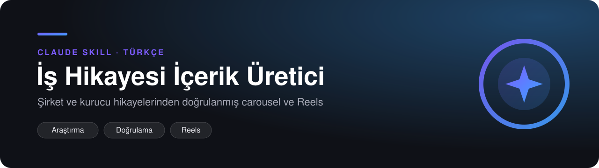

<p align="center"></p>

<p align="center">
  
  
  
</p>

<p align="center"><b>Şirket ve kurucu hikayelerinden doğrulanmış carousel ve Reels</b></p>

---

## ✨ Ne yapar

Bir şirket, kurucu ya da haber linkini kaynakları doğrulanmış bir Instagram carousel'ine veya Reels senaryosuna dönüştüren bir Claude skill'i: en az üç bağımsız kaynak, her rakam çapraz kontrol edilmiş, net bir hikaye akışı ve kullanıma hazır slayt metni, caption, hashtag, görsel brief ve kaynak listesi.

- **Önce doğrulama:** her rakam iki kaynakla kontrol edilir; tek kaynaklı iddialar "iddia edilen" diye işaretlenir veya çıkarılır.
- **Hikaye akışı:** kanca → sorun → dönüm noktası → rakamlarla sonuç → ders → soru.
- **Reels kanca kuralları:** tarihle açılmaz, kanca 5,5 sn'de biter, 15 sn içinde ikinci bir dönüm.
- **Sorumlu:** yalnızca lisanslı görsel, hassas konularda yorum yok, onaysız hiçbir şey yayınlanmaz.

## 💬 Nasıl kullanılır

Skill'i yükledikten sonra Claude'a doğal dilde yazman yeterli:

> "Getir'in yükseliş ve düşüş hikayesini carousel yap."  
> "Bu haberden 45 saniyelik bir Reels senaryosu çıkar: <link>"  
> "Koç Holding'in kuruluş hikayesini kaynaklarıyla anlat."  

## ⚙️ Kurulum

**Claude Code**
```bash
git clone https://github.com/erencalik/is-hikayesi-icerik-uretici-claude.git ~/.claude/skills/is-hikayesi-icerik-uretici
```
**claude.ai:** repoyu ZIP olarak indir (Code → Download ZIP) ve Ayarlar → Yetenekler → Skills altından yükle.

<details>
<summary>Dosyalar</summary>

| | |
|---|---|
| `SKILL.md` | skill talimatları |
| `README.md` | bu sayfa |
| `assets/banner.svg` | banner |
| `LICENSE` | MIT |

</details>

## 🔗 Birlikte çalıştığı skill'ler

| Repo | Ne yapar |
|---|---|
| [`instagram-weekly-content-planner-claude`](https://github.com/erencalik/instagram-weekly-content-planner-claude) | Weekly plan, niche research and post audits, ranked by evidence |
| [`instagram-aciklama-carousel-metni-claude`](https://github.com/erencalik/instagram-aciklama-carousel-metni-claude) | Caption, hashtag, alt metin ve carousel metni, kontrol makbuzuyla |
| [`instagram-carousel-design-system-claude`](https://github.com/erencalik/instagram-carousel-design-system-claude) | From a brand interview to pixel-checked 1080×1350 PNG slides |
| [`motion-graphics-video-generator-claude`](https://github.com/erencalik/motion-graphics-video-generator-claude) | One request to a scored MP4: HTML, headless Chromium, ffmpeg |

Tüm skill'ler ve aralarındaki akış için: [`claude-skills-collection`](https://github.com/erencalik/claude-skills-collection)

## 📄 Kaynak ve lisans

Özgün skill. MIT lisanslı, bkz. [LICENSE](LICENSE).
